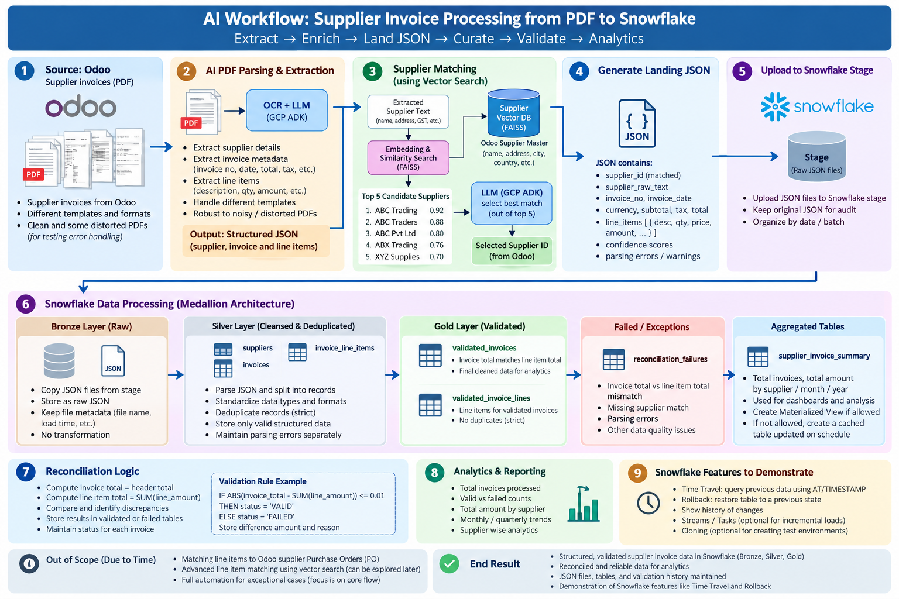

# AI-Assisted Supplier Invoice Processing and Reconciliation

## Overview

This project demonstrates an end-to-end data engineering and AI workflow for processing supplier invoices.

Odoo is used as the upstream business system and contains supplier reference data.

Supplier invoices are provided as PDF files. These invoices may:

- Use different invoice templates
- Be digitally generated PDFs
- Be scanned from paper copies
- Contain distorted or garbled text
- Have low-quality scans
- Contain OCR errors
- Contain non-English text
- Have missing or unclear fields

The objective is to extract invoice data, identify the correct supplier, load the data into Snowflake, and perform reconciliation and validation.

A sample of invoice is given in assets directory, file named Scanned-PDF.pdf

[Scanned PDF](assets/Scanned-PDF.pdf)


---

## Architecture Diagram

Use MySQL, create supplier table, feed data from customers dataset, where we have suppliers data, about 38 of them. **No need to connect Odoo PostgreSQL**, however during presentation, you still say that you validated against Odoo supplier records. Your Mysql will be used for RAG.



---

# 1. Source Data

The main input is supplier invoice PDF files.

Invoices may come from different suppliers and may have different layouts.

The invoice may contain:

- Supplier name
- Supplier address
- Tax/GST/VAT information
- Invoice number
- Invoice date
- Currency
- Subtotal
- Tax amount
- Invoice total
- Product or service descriptions
- Quantity
- Unit price
- Line amount

Some PDFs may be intentionally distorted or incomplete to test error handling.

---

# 2. AI-Based PDF Parsing

Use OCR and AI/LLM-based parsing to extract structured data from the invoice. Always remember, you don't prove that all invoices are correct. 
All you do is, is there discrepancies in the data extracted from PDFs. 

The parser should attempt to extract:

## Supplier Information

- Supplier name
- Address
- City
- State
- Country
- Tax/GST/VAT number
- Other available supplier identifiers

## Invoice Information

- Invoice number
- Invoice date
- Currency
- Subtotal
- Tax amount
- Total amount

## Line Items

- Description
- Quantity
- Unit price
- Amount

The parser should also capture:

- Parsing confidence where available
- Missing fields
- OCR problems
- Parsing warnings
- Unsupported or unclear text

---

# 3. Standard JSON Output

Each parsed invoice must be converted into a standard JSON format.
You may assume that supplier data is approximate, you may not be sure, it is fully correct, it was the reason, why you use Venctor DB, RAG to get Supplier data to enrich order data. 

Example:

```json
{
  "supplier_raw": {
    "name": "ABC Trading Pvt Ltd",
    "address": "Hyderabad",
    "tax_id": "GST123456"
  },
  "invoice": {
    "invoice_no": "INV-10025",
    "invoice_date": "2026-10-15",
    "currency": "INR",
    "subtotal": 10000,
    "tax": 1800,
    "total": 11800
  },
  "line_items": [
    {
      "description": "Product A",
      "quantity": 2,
      "unit_price": 5000,
      "amount": 10000
    }
  ],
  "parsing_status": "SUCCESS"
}
